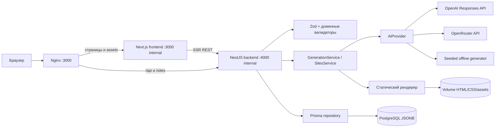

# Архитектура Company Creator

## Общая схема

Nginx, Next.js и NestJS являются отдельными контейнерами. Только Nginx публикует порт на host. Он проксирует `/api/*` и `/sites/*` в backend, а остальные пути — во frontend. Браузер работает с одним origin; Next.js использует внутренний адрес backend для SSR. Весь доступ к данным, ключам, внешним провайдерам и файловым артефактам находится в backend.

## Границы компонентов

| Компонент | Ответственность |
| --- | --- |
| `infra/nginx` | закреплённый образ Nginx, единый origin, forwarded headers и proxy healthcheck |
| `apps/frontend/src/app` | страницы, серверная загрузка данных и маршрутизация |
| `apps/frontend/src/components` | формы, polling задач и действия пользователя |
| `apps/frontend/src/lib/api.ts` | единая настройка внутреннего и браузерного URL backend |
| NestJS controllers | HTTP-контракт, статусы и безопасные ответы |
| NestJS services | оркестрация генерации, retry, бюджет и версии сайтов |
| `src/lib/domain` | канонический `CompanyProfile`, Zod и инварианты |
| `src/lib/ai` | `AiProvider`, OpenAI/OpenRouter и Structured Outputs |
| `RepositoryService` | единственная граница чтения/записи Prisma с повторной валидацией |
| `src/lib/site` | детерминированная сборка и безопасный доступ к артефактам |

## PostgreSQL и Prisma

Prisma использует три таблицы:

- `companies` — индексируемые метаданные и полный `profile` в `JSONB`;
- `site_versions` — неизменяемый номер, полный `snapshot`, checksum и путь артефакта;
- `generation_jobs` — состояние, попытка, стоимость, безопасная ошибка и результат.

Схема находится в `apps/backend/prisma/schema.prisma`, миграции — в `apps/backend/prisma/migrations`. Production-контейнер перед запуском выполняет `prisma migrate deploy`. `SeedService` идемпотентно добавляет два примера после подключения к базе.

## Канонические данные

`CompanyProfile` — единственный источник фактов. Он содержит обе локализации, контакты, продукт, пять FAQ, команду и метаданные генерации. Формальная схема опубликована в [company-profile.schema.json](company-profile.schema.json).

Внешний ввод, AI-ответы, импорт и изменённая карточка проверяются Zod и доменными валидаторами до сохранения. Репозиторий повторно валидирует JSON при чтении, поэтому повреждённая запись не может незаметно попасть в рендер.

## Жизненный цикл и задачи

1. Backend создаёт `generation_job` со статусом `queued`.
2. UI опрашивает `GET /api/jobs/:id`.
3. AI-задача проверяет максимальную стоимость до запроса, валидирует ответ и допускает не более одного retry внутри бюджета.
4. Профиль сохраняется как `draft`, ревизия `1`.
5. Редактирование увеличивает ревизию и всегда возвращает `draft`; пользователь снова утверждает профиль.
6. Сайт можно создать только из `approved`-профиля.

Задачи выполняются внутри одного процесса NestJS. Это осознанное ограничение локального MVP: после аварийного завершения незаконченная задача не возобновляется автоматически.

## Неизменяемые сайты

При создании версии backend копирует профиль в `snapshot`. Рендерер собирает три HTML-страницы, CSS, favicon и копии портретов каждого сотрудника во временном каталоге, вычисляет SHA-256 и атомарно сохраняет каталог в volume. Загруженные фото имеют неизменяемые UUID-пути; PNG-коллажи примеров поддерживаются для обратной совместимости.

Preview и ZIP читают этот же `artifact_path`; актуальная строка компании не используется. Поэтому дальнейшее редактирование карточки не меняет ранее созданный сайт.

## Секреты и сеть

Ключи OpenAI/OpenRouter передаются только backend-контейнеру через `.env`. Панель не содержит интерфейса или API для их записи. Значения используются при серверных запросах, маскируются в ошибках и не передаются frontend, PostgreSQL или артефактам сайтов.

Backend и frontend не публикуют host-порты, а Nginx передаёт стандартные `X-Forwarded-*` заголовки. Статические сайты не содержат внешних зависимостей, а preview разрешает только фиксированный список файлов. Загрузка фотографий доступна только в панели: ограничение размера действует в Nginx и multipart-парсере, sharp декодирует допустимые форматы и сохраняет JPEG без метаданных в отдельный volume.

## Возможное развитие

Для многопользовательского или горизонтально масштабируемого режима потребуются авторизация, отдельная очередь/worker, распределённая блокировка версий и объектное хранилище. Эти компоненты не входят в локальный MVP и текущий HTTP-контракт их не предполагает.
