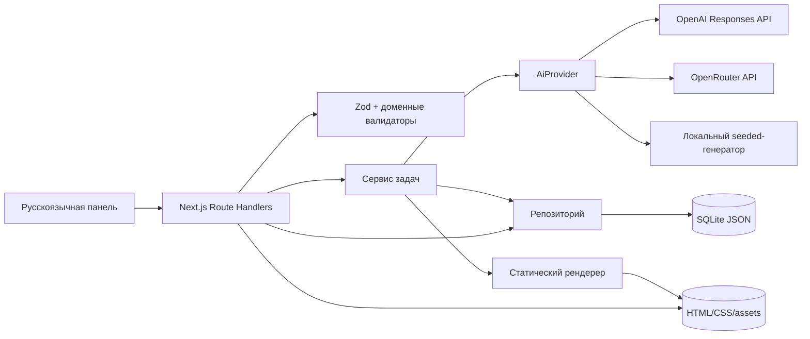

# Архитектура Company Creator MVP

## Общая схема

Next.js используется как full-stack приложение: React отвечает за интерфейс, а Route Handlers образуют серверную HTTP-границу. Ключи провайдеров, SQLite и файловые артефакты недоступны клиентскому bundle.

## Слои

| Слой | Ответственность |
| --- | --- |
| `src/app` | страницы, маршрутизация и HTTP-контроллеры |
| `src/components` | формы, polling задач и пользовательские действия |
| `src/lib/domain` | канонический `CompanyProfile`, каталоги и инварианты |
| `src/lib/ai` | интерфейс `AiProvider`, адаптеры, Structured Outputs и стоимость |
| `src/lib/generation` | оркестрация задач, retry и offline-генерация |
| `src/lib/db` | Drizzle-схема, SQLite и репозиторий |
| `src/lib/site` | детерминированная сборка и безопасный доступ к артефактам |

HTTP-контроллеры остаются тонкими: они валидируют вход, вызывают сервис или репозиторий и формируют безопасный ответ. Это упрощает последующее выделение backend.

## Канонические данные

`CompanyProfile` — единственный источник фактов о компании. Профиль содержит обе локализации, контакты, продукт, ровно пять FAQ, команду и метаданные генерации. Формальная схема опубликована в [`company-profile.schema.json`](company-profile.schema.json).

SQLite содержит три таблицы:

- `companies` — индексируемые метаданные и `profile_json`;
- `site_versions` — номер версии, полный `snapshot_json`, checksum и путь артефакта;
- `generation_jobs` — состояние, попытка, стоимость, безопасная ошибка и результат.

Таблицы создаются идемпотентно при первом обращении. SQLite работает в WAL-режиме с включёнными внешними ключами.

## Жизненный цикл компании

1. Генератор создаёт профиль со статусом `draft` и ревизией `1`.
2. Zod и доменная проверка выполняются до записи.
3. Пользователь редактирует обе локализации и утверждает карточку.
4. Любое последующее редактирование увеличивает ревизию и возвращает `draft`.
5. Новая версия сайта разрешена только для `approved`.

Доменная проверка дополнительно контролирует городской телефонный код, уникальность команды и ID, полноту RU/DE и отсутствие незаменённых шаблонов.

## Задачи и бюджет

Генерация запускается асинхронно, а интерфейс опрашивает `GET /api/jobs/:id`. AI-задача до запроса вычисляет максимальную оценку по разрешённой цене модели. Повторная попытка допускается только одна и только если верхняя оценка помещается в оставшийся бюджет.

Ошибки очищаются перед сохранением и выдачей. Входные параметры задачи не возвращаются клиенту, чтобы серверные детали не стали случайной частью публичного контракта.

## Неизменяемые сайты

При создании сайта профиль копируется в `snapshot_json`. Рендерер собирает `index.html`, `product.html`, `company.html`, CSS, favicon и локальное изображение команды во временном каталоге, вычисляет SHA-256 и атомарно переименовывает каталог.

Preview и ZIP используют сохранённый `artifact_path`; текущая строка компании не участвует в повторном рендере. Поэтому редактирование компании не меняет уже созданные версии.

## Граница будущего Nest.js

Текущий MVP не содержит отдельного Nest.js-сервера. При следующем этапе можно перенести HTTP-контроллеры и выполнение задач в Nest.js, сохранив без изменения:

- доменную Zod-модель и валидаторы;
- `AiProvider` и оба внешних адаптера;
- offline-генератор;
- репозиторий и структуру SQLite либо миграцию на другую БД;
- статический рендерер и формат артефактов;
- существующий HTTP-контракт для Next.js frontend.

После выделения backend Next.js останется UI/BFF-клиентом, а фоновые задачи можно перенести в отдельный worker и очередь.
